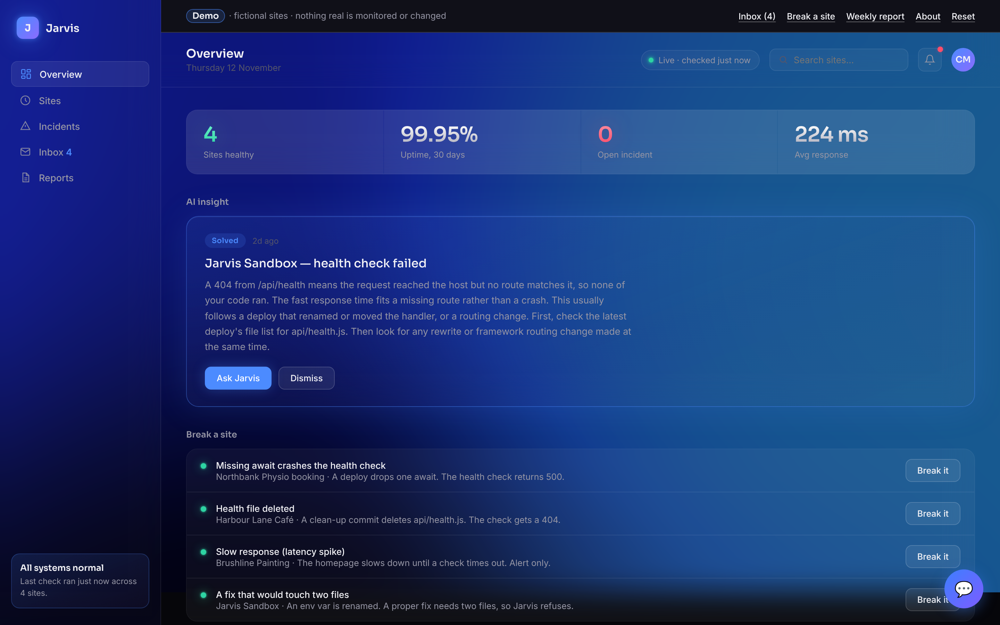

# Jarvis: a site monitor that explains outages and proposes fixes

Checks my sites every 15 minutes, explains outages in plain English, and opens a small, guarded fix PR I can approve from my phone.

**[Live demo](https://cian-jarvis-demo.vercel.app)** · **[Portfolio](https://cianmccaul.vercel.app)**



The real dashboard sits behind a sign-in and shows my clients' sites, so the screenshot and the live demo come from [jarvis-demo](https://github.com/cianmccaul/jarvis-demo): the same dashboard design and fix logic, run on four fictional sites.

I look after a few websites for small businesses. I wanted to know when one went down before a customer did, understand why without digging through logs, and fix small problems from my phone. Jarvis does that.

Every 15 minutes it checks each site. When one goes down, it asks an AI model what the symptoms most likely mean, emails me a plain-English explanation, and, if the fix is small and safe, opens a pull request I can approve with one tap.

## What it does

**Health checks every 15 minutes.** A GitHub Actions workflow requests each site in `sites.json` and records whether it's up, the status code and the response time. It only alerts on a *change* (up to down, or down to up), so a long outage means one email, not a hundred.

**Plain-English explanations.** When a site goes down, the symptoms (status code, error, response time) go to an LLM through Groq. The 3 to 4 sentence explanation, with suggested next steps, goes into the alert email and the incident log.

**Guarded auto-fix pull requests.** Jarvis can propose a fix, but the rules that keep it safe are enforced in code, not just written into a prompt:

1. It never touches `main`. It only ever opens a pull request.
2. A fix may change **one file only**. Anything touching more is rejected.
3. A fix must be **15 changed lines or fewer**. Anything bigger is flagged for manual review.
4. It uses a GitHub token scoped **only to the monitored sites' repos**. It can't modify itself.
5. If anything is ambiguous or fails, it **fails closed**: no PR, just a note in the email.

It finds the right file deterministically first (for example `/api/health` maps to `api/health.js`) and only asks the model to guess when that doesn't work. Fixes are applied as small find-and-replace snippets, never full-file rewrites.

**Approve from your phone.** Alert emails contain a signed link that expires after 7 days. Opening it shows a confirmation page; it never merges on page load, because email scanners follow links automatically. One tap on "Confirm merge" merges the PR, and Vercel redeploys the site.

**Weekly health report.** Every Monday it runs, per site:
- a Google PageSpeed audit
- a security headers check
- a Playwright smoke test that loads the page in a real browser
- a visual comparison against last week's screenshot, to catch layouts that break quietly

Reports are stored in Vercel Blob and emailed as a summary.

**Dashboard.** A small web app, installable on an iPhone home screen, showing live status, the incident history, past reports, and an **Ask Jarvis** chat to talk through any incident with the AI.

## How it works

```
GitHub Actions (every 15 min)            GitHub Actions (Mondays)
  scripts/check.js                         scripts/weeklyReport.js
   ├─ request each site                     ├─ PageSpeed, headers, smoke test
   ├─ on change: Groq explains it           ├─ screenshot diff vs last week
   ├─ scripts/proposeFix.js (guarded PR)    ├─ store in Vercel Blob
   ├─ email via Resend                      └─ email summary
   └─ commit status.json / incidents.json
                 │
                 ▼
Dashboard on Vercel  (dashboard/)
   ├─ index.html     status, incidents, reports, Ask Jarvis chat
   ├─ api/chat.js    stateless chat endpoint (Groq)
   ├─ api/approve.js human-confirmed PR merge
   ├─ api/login.js + middleware.ts   cookie session sign-in
```

No database: state lives in JSON files the workflow commits back to the repo, which also keeps a full audit trail of every status change.

## Run it locally

There's no `package.json`; the workflows install what they need. To try one health check from your own machine:

```
npm install --no-save groq-sdk resend @octokit/rest
GROQ_API_KEY=... RESEND_API_KEY=... NOTIFY_EMAIL=you@example.com node scripts/check.js
```

It checks every site in `sites.json` and writes `dashboard/status.json` (and `incidents.json` when something changes). `FIX_PR_TOKEN` is optional; without it Jarvis explains outages but never proposes a fix.

### Running your own instance

This public copy has its schedules turned off. The live instance runs from a private repo. To run your own:

1. Put your sites in `sites.json` (name, URL, and the GitHub repo that deploys it).
2. Add these repository secrets: `GROQ_API_KEY`, `RESEND_API_KEY`, `NOTIFY_EMAIL`, `FIX_PR_TOKEN` (a fine-grained token with access to your sites' repos only), plus `BLOB_READ_WRITE_TOKEN` and `PAGESPEED_API_KEY` for weekly reports.
3. Restore the `schedule:` lines in `.github/workflows/check.yml` and `weeklyReport.yml`.
4. Deploy `dashboard/` to Vercel with `GROQ_API_KEY`, `FIX_PR_TOKEN`, `DASHBOARD_USER`, `DASHBOARD_PASSWORD` and `DASHBOARD_SESSION_SECRET`. `WORKFLOW_TRIGGER_TOKEN` is optional: if set, approving a fix also re-runs the health check straight away (the repo it triggers is set in `dashboard/api/approve.js`). Also change `DASHBOARD_URL` at the top of `scripts/check.js` to your dashboard's address, so the approve links in emails point at it.

`dashboard/status.json`, `incidents.json` and `reports-index.json` are real data from my own sites, left in as examples.

## Tests

There are no automated tests in this repo. The guard rails (route-to-file lookup, find-and-replace fix, changed-line count) are ported into [jarvis-demo](https://github.com/cianmccaul/jarvis-demo), where you can watch each one pass or fail.

## Built with

Node.js, GitHub Actions, Groq (LLM), Resend (email), Octokit (GitHub API), Playwright, pixelmatch, Google PageSpeed API, Vercel and Vercel Blob.

---

Built by [Cian McCaul](https://github.com/cianmccaul).
